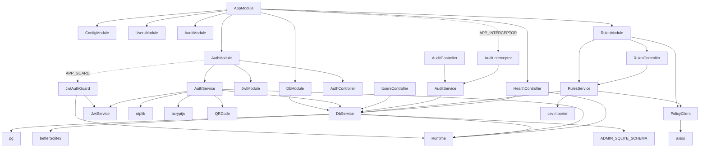
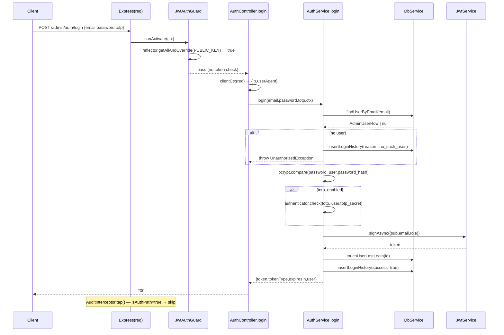
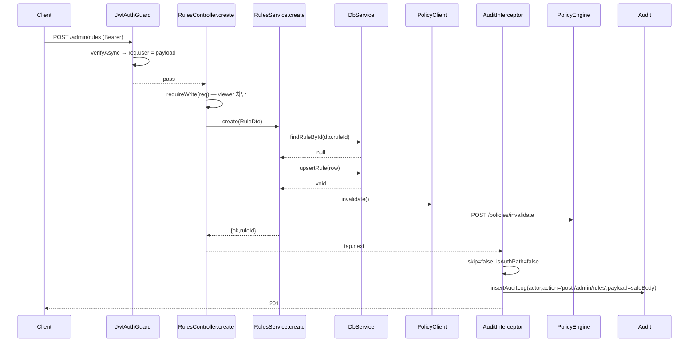
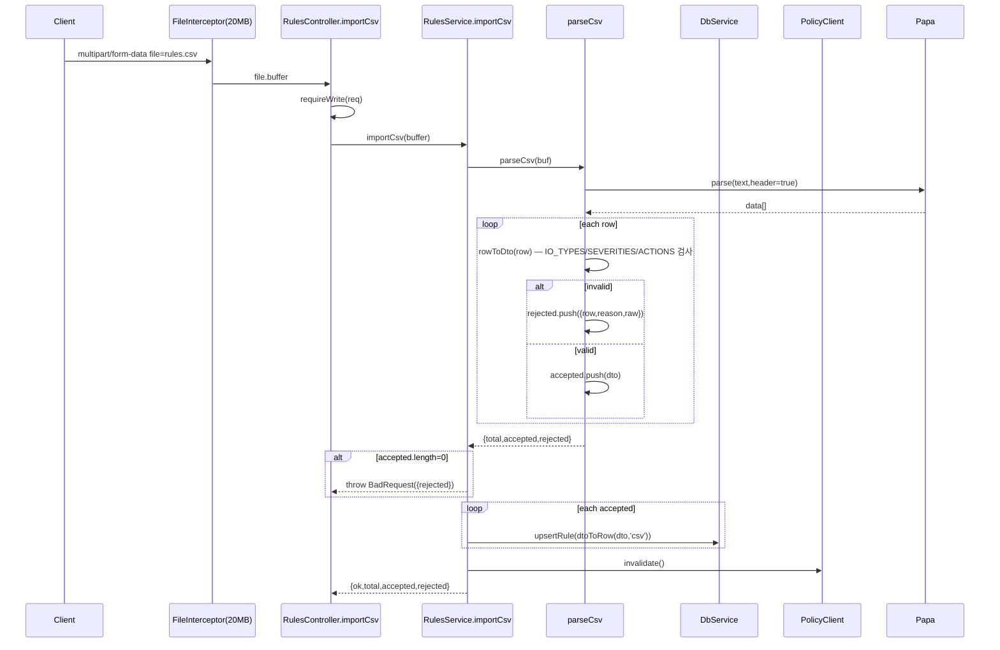

# Guardrails-Service-Admin — Level 2 Code Review (Lv2)

- 분석일 / Date: 2026-05-20
- 대상 / Target: `/Users/wise/Developer/Web(Node,Script)/Guardrails-Service-Admin`
- 리뷰 레벨 / Review Level: **Level 2 (줄별 + 부작용/동시성/문법 트랩 분석)**
- 선택 파일 / Files Selected: 21 / 21 source files (cap 40, none deferred)
- 분석 도구 / Analyzed by: Claude (Opus 4.7, 1M context)

---

## 1. Workspace Inventory

### 1.1 디렉터리 트리 (depth 4)

```
Guardrails-Service-Admin/
├── .dockerignore
├── .env.example
├── Dockerfile
├── README.md
├── nest-cli.json
├── package.json
├── tsconfig.json
└── src/
    ├── main.ts                      # NestFactory 부트스트랩, CORS, /admin 글로벌 prefix
    ├── app.module.ts                # 루트 모듈 + APP_INTERCEPTOR(AuditInterceptor)
    ├── audit/
    │   ├── audit.controller.ts      # /audit/login-history, /audit/actions
    │   ├── audit.interceptor.ts     # 변형(POST/PUT/DELETE) 자동 감사
    │   ├── audit.module.ts          # @Global() AuditService 노출
    │   └── audit.service.ts         # DB 래퍼
    ├── auth/
    │   ├── auth.controller.ts       # /auth/* register/login/me/totp/password
    │   ├── auth.module.ts           # JwtModule.register + APP_GUARD(JwtAuthGuard)
    │   ├── auth.service.ts          # bcrypt + otplib + qrcode + JwtService.sign
    │   ├── dto.ts                   # Register/Login/EnableTotp/ChangePassword DTOs
    │   ├── jwt.guard.ts             # Bearer 토큰 검증, @Public 통과
    │   └── public.decorator.ts      # SetMetadata(PUBLIC_KEY,true)
    ├── clients/
    │   └── policy.client.ts         # Policy Engine /policies/invalidate 호출
    ├── config/
    │   └── runtime.ts               # 환경변수 → 정적 Runtime 객체
    ├── db/
    │   ├── db.module.ts             # @Global() DbService 노출
    │   ├── db.service.ts            # PG/SQLite 듀얼 드라이버 facade (~460 LOC)
    │   └── schema.sqlite.ts         # SQLite 부트스트랩 DDL
    ├── health/
    │   └── health.controller.ts     # GET /admin/health (Public)
    ├── rules/
    │   ├── csv-importer.ts          # papaparse 기반 CSV → RuleDto 변환
    │   ├── dto.ts                   # RuleDto / BulkUpsertDto / BulkDeleteDto
    │   ├── rules.controller.ts      # /rules CRUD + bulk + import-csv
    │   ├── rules.module.ts          # RulesService + PolicyClient 주입
    │   ├── rules.service.ts         # 비즈니스 로직 + invalidate 호출
    │   └── __tests__/
    │       └── csv-importer.spec.ts # Jest 단위 테스트(5케이스)
    └── users/
        ├── users.controller.ts      # GET /users (super_admin만)
        └── users.module.ts
```

### 1.2 파일 수 / 언어별 통계

| 카테고리 | 수치 |
|---|---|
| TypeScript 소스 (`.ts`) | 21 |
| 테스트 파일 (`*.spec.ts`) | 1 (csv-importer.spec.ts) |
| 매니페스트 (json) | 3 (package.json / tsconfig.json / nest-cli.json) |
| 컨테이너 (Dockerfile/.dockerignore) | 2 |
| 환경 템플릿 (.env.example) | 1 |
| Markdown (README) | 1 |
| Lockfile | **확인 불가 — 파일 부재** (package-lock.json/yarn.lock 없음) |

### 1.3 빌드 매니페스트 & 버전

- `package.json` — `"name": "guardrails-admin"`, `version: 0.1.0`, `main: dist/main.js`
  - 런타임 deps 핵심: `@nestjs/common@^10.3.0`, `@nestjs/jwt@^10.2.0`, `bcryptjs@^2.4.3`, `otplib@^12.0.1`, `qrcode@^1.5.3`, `pg@^8.11.5`, `better-sqlite3@^11.0.0`, `papaparse@^5.4.1`, `multer@^1.4.5-lts.1`, `class-validator@^0.14.1`, `axios@^1.6.8`, `zod@^3.22.4` (선언만 — import는 없음)
  - dev deps: jest 29, ts-jest, supertest(미사용), typescript 5.4
- `tsconfig.json` — `target: ES2022`, `module: commonjs`, `strict: true`, `experimentalDecorators: true`, `emitDecoratorMetadata: true`
- `nest-cli.json` — `sourceRoot: src`, `compilerOptions.deleteOutDir: true`
- `Dockerfile` — Node 20 알파인 2-stage, `RUN apk add --no-cache python3 make g++` (better-sqlite3 native build), `EXPOSE 8084`, `CMD ["node", "dist/main.js"]`
- Lockfile 부재 → 재현 가능한 빌드 보장 없음 (위험)

### 1.4 진입점 / 엔트리포인트

- `src/main.ts` — `bootstrap()` (NestFactory.create → AppModule)
- 단일 HTTP 서버, 포트 `8084`, prefix `/admin`
- 헬스: `GET /admin/health` (Public)
- AppModule.onModuleInit → AuthService.onModuleInit → 부트스트랩 super_admin 자동 생성

### 1.5 테스트 디렉터리

- `src/rules/__tests__/csv-importer.spec.ts` — 단일 테스트 파일 (5개 케이스)
- 컨트롤러/서비스/Guard/Interceptor에 대한 단위·통합 테스트 없음

---

## 2. Project Structure

### 2.1 Source Tree (depth 4, 역할 주석)

위 1.1 참고. 9 디렉터리(`src/{audit,auth,clients,config,db,health,rules,rules/__tests__,users}`).

### 2.2 모듈 의존성 그래프



핵심 관찰:
- DbModule + AuditModule + AuthModule이 `@Global()`로 등록되어 어디서나 주입 가능
- `JwtAuthGuard`는 `APP_GUARD`로 전역 적용 → 명시적 `@UseGuards`는 컨트롤러 레벨 보조
- `RulesModule`은 `@Global()`이 아니라 자체 `PolicyClient`를 provider로 가짐
- `zod` 패키지는 런타임 deps에 있으나 import 없음 (death dep)

### 2.3 호출/응답 흐름 (대표 진입점)

#### (A) 로그인 — `POST /admin/auth/login`



#### (B) 규칙 단건 생성 — `POST /admin/rules`



#### (C) CSV 임포트 — `POST /admin/rules/import-csv`



### 2.4 Third-party Package Inventory

| 패키지 | 버전 | 사용처 | 역할 | 라이선스 |
| :-- | :-- | :-- | :-- | :-- |
| @nestjs/common | ^10.3.0 | 전 영역 | DI, decorators | MIT |
| @nestjs/core | ^10.3.0 | main.ts, AppModule | NestFactory, APP_INTERCEPTOR/GUARD | MIT |
| @nestjs/config | ^3.2.0 | app.module.ts | ConfigModule.forRoot | MIT |
| @nestjs/jwt | ^10.2.0 | auth.module/auth.service/jwt.guard | JWT sign/verify | MIT |
| @nestjs/platform-express | ^10.3.0 | rules.controller, main | Express + Multer adapter | MIT |
| axios | ^1.6.8 | clients/policy.client.ts | HTTP client (timeout 3s) | MIT |
| bcryptjs | ^2.4.3 | auth.service.ts | password hashing (rounds env-driven) | MIT |
| better-sqlite3 | ^11.0.0 | db.service.ts (동적 import) | SQLite synchronous driver | MIT |
| class-transformer | ^0.5.1 | rules/dto.ts (`@Type()`) | DTO 객체 변환 | MIT |
| class-validator | ^0.14.1 | auth/dto.ts, rules/dto.ts | DTO 유효성 검사 | MIT |
| multer | ^1.4.5-lts.1 | rules.controller.ts (FileInterceptor) | multipart 파일 업로드 | MIT |
| otplib | ^12.0.1 | auth.service.ts | TOTP generateSecret/keyuri/check | MIT |
| papaparse | ^5.4.1 | csv-importer.ts | CSV parser | MIT |
| pg | ^8.11.5 | db.service.ts | Postgres Pool | MIT |
| qrcode | ^1.5.3 | auth.service.ts | toDataURL → PNG data URL | MIT |
| reflect-metadata | ^0.2.0 | 데코레이터 메타 | required by Nest | MIT |
| rxjs | ^7.8.1 | audit.interceptor.ts (`tap`) | Observable pipe | Apache-2.0 |
| zod | ^3.22.4 | **미사용 (dead dep)** | — | MIT |

### 2.5 Data Flow & State Stores

**참조 테이블 (스키마는 [`src/db/schema.sqlite.ts`](../../src/db/schema.sqlite.ts) 및 외부 `init-db.sql` Postgres 미러):**

- `admin_users` — id(uuid TEXT PK), email UNIQUE, password_hash(bcrypt), totp_secret(평문 base32!), totp_enabled INT/BOOL, role CHECK(admin|super_admin|viewer), status CHECK(active|disabled), created_at, last_login_at
- `admin_login_history` — id, user_id(nullable), email, ip, user_agent, success, reason, created_at; index: `(user_id, created_at DESC)`
- `admin_audit_log` — id, actor_id, actor_email, action, target_type, target_id, payload(TEXT JSON in sqlite / JSONB in PG), ip, user_agent, created_at; indexes: actor+time, action+time
- `rules` — rule_id PK, domain, locale, io_type CHECK, category, sub_category, severity CHECK, priority INT, action TEXT(체크 없음 — DTO 레벨에서만 검증), pattern_bundle/message_template/regulation_tags/examples_*(SQLite TEXT JSON; PG JSONB/배열로 추정), enabled INT/BOOL, version, source CHECK(file|admin|csv), created_at, updated_at; partial index on `enabled=1`

**캐시:** 자체 캐시 없음. 대신 Policy Engine cache invalidation을 모든 write 직후 호출 (`POST /policies/invalidate`, 3s timeout, 실패는 swallow + warn).

**Config 소스:** `process.env` (`@nestjs/config`의 ConfigModule은 forRoot만 호출, `Runtime` 객체에서 직접 process.env 사용 → ConfigService 미사용으로 일관성 약함).

**I/O 경계:**
- HTTP 인바운드: Express on :8084, prefix `/admin`
- HTTP 아웃바운드: axios → Policy Engine `/policies/invalidate`
- DB: pg(Pool, max 10) 또는 better-sqlite3 (동기 driver를 async 메서드에서 사용)
- 파일: SQLite 파일 (Runtime.sqlitePath, default `./var/admin.db`), `mkdirSync(dirname,recursive)`
- 메모리: Multer in-memory (default) 20MB CSV

**JWT/TOTP/Bcrypt:**
- JWT: HS256 (기본), `JWT_SECRET` env 직참조, `expiresIn` 기본 12h
- TOTP: `otplib.authenticator` 기본 옵션(SHA1, 30초 스텝). secret은 **DB에 평문 base32로 저장** — 환경변수 등의 KMS-wrapping 없음
- Bcrypt: `bcryptjs` (pure-JS, slow), rounds 기본 10

### 2.6 진입점 번호 매김

1. `bootstrap()` → main.ts:15
2. `GET /admin/health` → health.controller.ts:11
3. `POST /admin/auth/register` (Public) → auth.controller.ts:21
4. `POST /admin/auth/login` (Public) → auth.controller.ts:27
5. `GET /admin/auth/me` (Bearer) → auth.controller.ts:32
6. `GET /admin/auth/totp/qr` → auth.controller.ts:39
7. `POST /admin/auth/totp/enable` → auth.controller.ts:44
8. `POST /admin/auth/password` → auth.controller.ts:50
9. `GET /admin/users` (super_admin only) → users.controller.ts:10
10. `GET /admin/audit/login-history` → audit.controller.ts:11
11. `GET /admin/audit/actions` → audit.controller.ts:26
12. `GET /admin/rules` → rules.controller.ts:21
13. `GET /admin/rules/:ruleId` → rules.controller.ts:42
14. `POST /admin/rules` → rules.controller.ts:47
15. `POST /admin/rules/bulk` → rules.controller.ts:53
16. `POST /admin/rules/import-csv` → rules.controller.ts:59
17. `PUT /admin/rules/:ruleId` → rules.controller.ts:72
18. `DELETE /admin/rules/:ruleId` → rules.controller.ts:78
19. `DELETE /admin/rules` (bulk) → rules.controller.ts:86

부수 진입점:
- `AuthService.onModuleInit` — 부트스트랩 super_admin 자동 시드
- `DbService.onModuleInit/onModuleDestroy` — 커넥션 라이프사이클

---

## 3. File Selection

선택 기준: 진입점 → 2-hop reachable → in-degree → tests → rest. 전체 21개 소스가 cap 40 이내 → **전수 분석**.

리뷰 매핑 (각 파일별 `.md` 리포트는 같은 상대경로):

| # | 파일 | 라인 | 비고 |
|--|--|--|--|
| 1 | `src/main.ts` | 41 | 진입점 |
| 2 | `src/app.module.ts` | 26 | 루트 모듈 |
| 3 | `src/config/runtime.ts` | 14 | 환경 정적 객체 |
| 4 | `src/db/db.module.ts` | 6 | @Global |
| 5 | `src/db/db.service.ts` | **460** | 핵심 facade (block-mode 불필요 — 600 미만이나 가장 큰 파일) |
| 6 | `src/db/schema.sqlite.ts` | 73 | DDL 문자열 |
| 7 | `src/auth/auth.module.ts` | 25 | JwtModule.register |
| 8 | `src/auth/auth.controller.ts` | 55 | /auth/* |
| 9 | `src/auth/auth.service.ts` | 141 | bcrypt + otplib + qrcode |
| 10 | `src/auth/dto.ts` | 41 | class-validator |
| 11 | `src/auth/jwt.guard.ts` | 37 | APP_GUARD |
| 12 | `src/auth/public.decorator.ts` | 3 | SetMetadata |
| 13 | `src/users/users.module.ts` | 5 | trivial |
| 14 | `src/users/users.controller.ts` | 18 | super_admin gating |
| 15 | `src/audit/audit.module.ts` | 11 | @Global |
| 16 | `src/audit/audit.controller.ts` | 41 | /audit/* |
| 17 | `src/audit/audit.service.ts` | 37 | thin |
| 18 | `src/audit/audit.interceptor.ts` | 53 | APP_INTERCEPTOR |
| 19 | `src/rules/rules.module.ts` | 11 | |
| 20 | `src/rules/rules.controller.ts` | 92 | /rules CRUD + upload |
| 21 | `src/rules/rules.service.ts` | 112 | |
| 22 | `src/rules/dto.ts` | 50 | |
| 23 | `src/rules/csv-importer.ts` | 98 | papaparse + 검증 |
| 24 | `src/rules/__tests__/csv-importer.spec.ts` | 51 | jest |
| 25 | `src/clients/policy.client.ts` | 21 | axios invalidate |
| 26 | `src/health/health.controller.ts` | 19 | Public |

---

## 4. Whole-Codebase Synthesis

### 4.1 반복 패턴

- **Duck-typed `(req as Request & { user: AuthedUser }).user`** — `auth.controller`, `users.controller`, `audit.controller`, `rules.controller` 4곳에서 똑같이 캐스팅. NestJS `@CurrentUser()` 커스텀 데코레이터로 추출하면 좋음.
- **PG/SQLite 분기 패턴** — `db.service.ts` 거의 모든 메서드가 `if (this.driver === 'sqlite') ... else ...`. 추상 어댑터(`PgAdapter`/`SqliteAdapter`)로 분리하면 가독성/테스트 용이성 ↑.
- **`req.headers['x-forwarded-for']` IP 추출** — `auth.controller.clientCtx`와 `audit.interceptor.clientIp` 두 곳에 거의 동일 코드. 공통 헬퍼 부재.
- **DTO `@IsIn(ARR as unknown as string[])` 강제 캐스팅** — `rules/dto.ts`에 3회. class-validator 타입과 const tuple의 호환 문제 회피용이지만 명확한 패턴.
- **JSON 직렬화 분기** — SQLite는 `JSON.stringify` 문자열 컬럼, PG는 객체/배열 그대로. `coerceRule`에서 다시 parse. 이 변환 비용이 모든 read에서 발생.

### 4.2 계층 위반 / 아키텍처 결함

1. **`Runtime` 정적 객체 vs `@nestjs/config`** — ConfigModule은 forRoot만 호출되고 실제 코드에서 ConfigService는 한 번도 사용되지 않음. 결과적으로 `Runtime`이 모듈 import-time에 `process.env` 스냅샷. 테스트 시 env override 어려움.
2. **`JwtAuthGuard`가 `Runtime.jwtSecret`을 직접 참조** — JwtModule.register에 이미 secret을 등록했으나 guard에서 secret을 또 직접 전달 (`{ secret: Runtime.jwtSecret }`). 일관성 약함. JwtModule 등록만 사용해도 됨.
3. **DbService가 도메인 로직(merge, JSON 파싱) 포함** — `RuleRow` 변환을 DbService가 책임. 도메인 모델/리포지토리 분리가 약함.
4. **AuditInterceptor가 `req.originalUrl`로 path 매칭** — `/admin/auth/`로 시작하면 skip. global prefix가 바뀌면 깨짐.
5. **`@Global() AuditModule`이 `controllers: [AuditController]`를 포함** — Global 모듈로 controller를 노출하면 컨트롤러도 어디서나 보일 위험은 없으나 관례상 controllers는 non-global에 두는 게 깔끔.

### 4.3 위험 핫스팟 Top-5

| # | 위치 | 심각도 | 요지 |
| :-- | :-- | :-- | :-- |
| 1 | `src/auth/auth.service.ts:24-27` (bootstrap) + `db/db.service.ts:138-159` | **Critical** | **TOTP secret이 DB에 평문(base32) 저장.** DB 유출 시 모든 admin의 2FA가 즉시 우회 가능. KMS/envelope 암호화나 최소한 application-layer AES-GCM 필요. 또한 register 응답이 평문 secret을 클라이언트로 그대로 전달. |
| 2 | `src/auth/auth.controller.ts:20-24` (`@Public() POST /auth/register`) | **Critical** | **자가-등록이 인증 없이 가능.** 누구나 admin 계정을 만들 수 있음 (role 까지 클라이언트가 지정 — `dto.role`이 super_admin 도 수락). PRD 의 "opt-in admin" 모델과 모순. 최소: register는 super_admin Bearer 요구, role은 서버에서 강제. |
| 3 | `src/config/runtime.ts:3` + `auth.module.ts:13` | **Critical** | **`JWT_SECRET`이 코드 기본값 `'change-me-in-prod'`로 fallback.** env 누락 시 부트가 성공하고 누구나 토큰을 forge 가능. 부재 시 **fail-fast** 필요. |
| 4 | `src/main.ts:5-13` (CORS) | **High** | `ADMIN_CORS_ORIGINS=*` 이면 `origin: true` (모든 origin reflect). `credentials:false`라 쿠키 비전송이지만, JWT는 헤더로 보내고 CORS는 모든 origin의 JS가 호출 가능 → CSRF성 위험 잔존. 또한 default origin에 `localhost:3000`이 포함 — prod 빌드에 새어나가면 dev origin 허용. |
| 5 | `src/auth/auth.controller.ts:27-30` (login) | **High** | **Rate limiting 부재.** brute-force/credential stuffing 무방비. `@nestjs/throttler` 또는 외부 WAF 필요. 더불어 `bad_password`와 `no_such_user`가 같은 메시지(`invalid_credentials`)지만 응답 시간 차(bcrypt 비교 유무)로 user-enumeration 가능. |

추가 보조 위험:
- `H1`: SQLite "async" 메서드 — better-sqlite3는 동기. event loop blocking 가능 (특히 bulk upsert 루프).
- `H2`: `RulesService.bulkUpsert` 트랜잭션 부재 → 부분 실패 시 일관성 깨짐.
- `H3`: `AuditInterceptor`가 read를 skip → 민감한 GET (예: super_admin의 cross-account audit 조회)은 감사 흔적 없음.
- `H4`: `BulkUpsertDto`는 10,000개까지 허용 — N+1 upsert + invalidate 1회. 10k행 동기 SQLite/단건 PG round-trip이면 long-blocking.
- `H5`: `parseCsv`는 전체 파일을 메모리에 로드(Multer memoryStorage + Papa 동기 파서). 20MB CSV에 수만 행이면 메모리 스파이크.

### 4.4 삭제 후보

- `zod@^3.22.4` 패키지 — 코드 import 없음.
- `supertest@^6.3.4` dev dep — 통합 테스트 없음.
- `src/auth/public.decorator.ts`는 keep, 단 `PUBLIC_KEY` 상수를 별도 파일(`auth/auth.constants.ts`)로 빼는 게 import 순환 방지에 안전 (현재 decorator가 guard에서 상수를 끌어옴 → 역의 import 방향 우연히 동작).

### 4.5 테스트 공백

- 인증 플로우 통합 테스트 0건 (register/login/totp/jwt verify/password change).
- AuditInterceptor 동작 검증 없음.
- Guards/Decorators 동작 검증 없음.
- DbService 의 PG/SQLite 분기 검증 없음.
- 단일 테스트(`csv-importer.spec.ts`)도 happy path와 enum reject만, 큰 페이로드/유니코드/이중-quote escape 시나리오 없음.

### 4.6 다음 단계 (권고 우선순위)

1. **(P0) JWT_SECRET / bootstrap creds 누락 시 fail-fast** + **register 엔드포인트 보호** + **TOTP secret 암호화 저장** (위 Top-5의 1~3).
2. **(P1) `@nestjs/throttler` 도입** — 최소 `/auth/login`에 IP+email 키 한정. CAPTCHA 또는 incremental backoff 보조.
3. **(P1) bulkUpsert/CSV 임포트 트랜잭션화** — pg `BEGIN/COMMIT`, sqlite `db.transaction()` 사용.
4. **(P2) `Runtime` → `ConfigService`로 통합** + .env 검증을 zod로 (이미 deps 존재).
5. **(P2) `JwtStrategy(passport-jwt)` 또는 최소 `JwtModuleAsync`** 사용으로 secret 단일 소스화.
6. **(P3) request-context 데코레이터** (`@CurrentUser()`, `@ClientCtx()`)로 중복 캐스팅 제거.
7. **(P3) DbService를 PgAdapter/SqliteAdapter로 분리**, JSON 변환 책임을 Repository에 위임.
8. **(P3) 통합 테스트** — supertest 이미 dev dep으로 있음. 최소 login → CRUD 한 사이클.

---

## 5. Appendices

### A. Deferred
없음 (전체 파일 분석).

### B. Full File Inventory
1.1 트리 참조.

상세 파일별 보고서:
- [`<root>_Abstract.md`](_Abstract.md)
- src/
  - [src_Abstract.md](src/src_Abstract.md)
  - [main.ts.md](src/main.ts.md)
  - [app.module.ts.md](src/app.module.ts.md)
  - config/
    - [config_Abstract.md](src/config/config_Abstract.md)
    - [runtime.ts.md](src/config/runtime.ts.md)
  - db/
    - [db_Abstract.md](src/db/db_Abstract.md)
    - [db.module.ts.md](src/db/db.module.ts.md)
    - [db.service.ts.md](src/db/db.service.ts.md)
    - [schema.sqlite.ts.md](src/db/schema.sqlite.ts.md)
  - auth/
    - [auth_Abstract.md](src/auth/auth_Abstract.md)
    - [auth.module.ts.md](src/auth/auth.module.ts.md)
    - [auth.controller.ts.md](src/auth/auth.controller.ts.md)
    - [auth.service.ts.md](src/auth/auth.service.ts.md)
    - [dto.ts.md](src/auth/dto.ts.md)
    - [jwt.guard.ts.md](src/auth/jwt.guard.ts.md)
    - [public.decorator.ts.md](src/auth/public.decorator.ts.md)
  - users/
    - [users_Abstract.md](src/users/users_Abstract.md)
    - [users.module.ts.md](src/users/users.module.ts.md)
    - [users.controller.ts.md](src/users/users.controller.ts.md)
  - audit/
    - [audit_Abstract.md](src/audit/audit_Abstract.md)
    - [audit.module.ts.md](src/audit/audit.module.ts.md)
    - [audit.controller.ts.md](src/audit/audit.controller.ts.md)
    - [audit.service.ts.md](src/audit/audit.service.ts.md)
    - [audit.interceptor.ts.md](src/audit/audit.interceptor.ts.md)
  - rules/
    - [rules_Abstract.md](src/rules/rules_Abstract.md)
    - [rules.module.ts.md](src/rules/rules.module.ts.md)
    - [rules.controller.ts.md](src/rules/rules.controller.ts.md)
    - [rules.service.ts.md](src/rules/rules.service.ts.md)
    - [dto.ts.md](src/rules/dto.ts.md)
    - [csv-importer.ts.md](src/rules/csv-importer.ts.md)
    - __tests__/
      - [csv-importer.spec.ts.md](src/rules/__tests__/csv-importer.spec.ts.md)
  - clients/
    - [clients_Abstract.md](src/clients/clients_Abstract.md)
    - [policy.client.ts.md](src/clients/policy.client.ts.md)
  - health/
    - [health_Abstract.md](src/health/health_Abstract.md)
    - [health.controller.ts.md](src/health/health.controller.ts.md)
